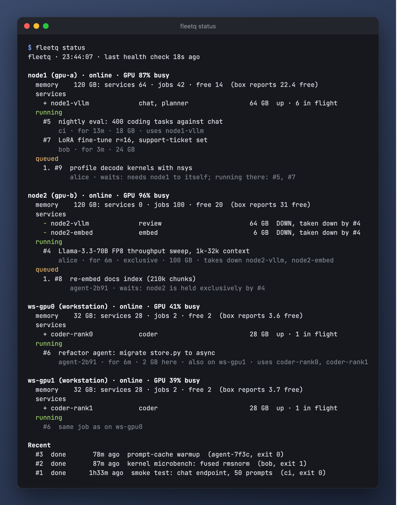

# fleetq

One queue for every job on a small fleet of GPU boxes. Before an agent, harness or person
starts work on a box, it asks fleetq for a slot. If the box is busy, the job waits in line
and starts when the jobs ahead of it are released. fleetq also health-checks the model
servers on each box, so agents can ask which models are up right now and where.



It is one stdlib-only Python package: a small HTTP server (`fleetqd`) that holds the queue
in SQLite, and a CLI (`fleetq`) that people, scripts and coding agents call. Examples below
use made-up names (hosts `gpu-a`, `gpu-b`, `gpu-c`; services such as `chat-a` and
`embed-a`); yours come from your roster.

## Install

Server, on any always-on Linux box or container with Python 3.11+ and systemd:

```bash
cp deploy/fleet.example.toml deploy/fleet.toml   # describe your hosts and services
deploy/install.sh root@your-server
```

The install creates the tokens (`/etc/fleetq/token`, and `/etc/fleetq/readonly_token` if the
roster names one) and keeps them and the database on re-runs.

Client, on every machine that starts work:

```bash
uv tool install git+https://github.com/OWNER/fleetq
echo http://your-server:8470 > ~/.config/fleetq/url
# copy /etc/fleetq/token from the server to ~/.config/fleetq/token (chmod 600)
```

`FLEETQ_URL` and `FLEETQ_TOKEN` override the files. The HTTP API is in
[docs/api.md](docs/api.md). Keep your own site notes in `deploy/LOCAL.md` (gitignored).


## Check before you start anything

```bash
fleetq status
```

It shows every box's services, their memory, what is running, what is waiting and why,
plus an **Attention** list: roles that are down or serving the wrong model without any
job accounting for it, stale or overdue jobs, and services not restored after a takedown.

## Find a model to use

```bash
fleetq models                 # every model that can take requests now
fleetq models --cap image     # only models that accept images
fleetq models --all --json    # also down, held and starting ones, for a harness
```

Each entry (`GET /v1/models`, same filters as `?cap=image,text&all=1`) has `model`, `url`,
`service`, `host`/`hosts`, `machine`, `roles`, `state`, `usable`, `capabilities`,
`capabilities_source`, `context` (vLLM's `max_model_len`), `root` (the checkpoint behind a
served name) and `age_s` (seconds since the last health check, at most about 30). A
harness should key on `(url, model)`: the same name (`reason-a`) can be served by two boxes.

- **Where it comes from.** Every 30 s the health check reads each service's `/models`.
  Without `--all`, only services that are usable right now are listed: a held, restoring,
  wedged or down service is left out even though its last answer is remembered.
  `verified: false` means the server needs a key (HTTP 401/403), so the models shown are the
  roster's `models`, not what it actually serves.
- **Capabilities** are `text`, `image`, `video`, `audio` (what a chat model accepts), `embed`
  and `rerank`. Servers do not report them, so the roster declares them per service
  (`capabilities = ["text", "image"]`) or per model
  (`model_capabilities = { vision-a = ["text"] }`). The server refuses to start on an unknown
  word, and `fleetqd --check` reports it; `--cap` and `--caps` reject one too.
  `capabilities_source` is `config`, `job` (from `--caps`) or `unknown` (nothing declared;
  empty list, so a `--cap` filter never picks it).
- **Models a job brings up.** Give the job `--serves URL` (repeatable) and optionally
  `--caps text,image`. While the job runs, the health check reads that URL too, and its models
  appear with `job` set (`state: starting` under `--all` until the server answers). They
  disappear when the job is released. `--serves` also places the job on that URL's box, like
  `--for-url`. Inside a covering `FLEETQ_JOB`, `--serves` is not recorded; give it to the parent.
  The server must listen where the fleetq server can reach it: a loopback URL is rewritten to
  this machine's name, but a server bound to 127.0.0.1 never answers the check and stays
  `starting`.

```bash
fleetq acquire --host gpu-b --mem 40 --serves http://gpu-b:8001/v1 --caps text,image \
  --label "try GLM 5.3V" --expect 90 --wait
```

## Run work

A benchmark or any single command: wait for a slot, run, release on exit (even on a crash).

```bash
fleetq run --host gpu-c0 --exclusive --label "Qwen3.8-27B speed bench" -- uv run evalbench speed ...
fleetq run --uses embed-a --exclusive --label "embed-a decode test" -- ./bench.sh
```

Multi-step work across several tool calls: acquire, work, release.

```bash
fleetq acquire --host gpu-b --mem 40 --label "try GLM 5.3" --expect 90 --wait
# ... work ...
fleetq release 57
```

**Keepalive.** A session that dies or forgets would otherwise hold its lease forever, so
`acquire` starts a small detached process that heartbeats the lease while the session that took
it lives: `FLEETQ_KEEPALIVE_PID` if set, else Claude Code's own process (`CLAUDE_PID`, or the
nearest ancestor named `claude`), else the shell of a human at a terminal. When that process
exits, the heartbeats stop: after `stale_heartbeat_s` the lease is flagged stale (and notified),
and after `abandon_after_s` (default 1200 s, long enough for a laptop to sleep a while) it is
released as `abandoned`. A lease that is `--exclusive` or `--takes-down` something is only
flagged, never released, since freeing a box mid-reboot is worse than waiting for someone to
look. With no session process to follow (some other harness whose shell exits after each
command), `acquire` says so and starts none. `--no-keepalive` skips it, for a lease another
process will release.

For Claude Code, [`deploy/claude-hooks.py`](deploy/claude-hooks.py) adds two hooks: at the end
of each turn, a session that still holds leases is asked once to release what it is done with;
when a session ends, its leases are released (exclusive and takes-down ones excepted). Its
docstring has the settings snippet.

Take a fleet role down to test something else. Anyone who needs the role waits until it is
back; fleetq only counts it back once a health check sees the expected model again.

```bash
fleetq acquire --takes-down embed-a --mem 90 --label "swap gpu-b to GLM 5.3" --wait
# stop the server, test, restart the normal server
fleetq release 58
```

### Several hosts in one job

Work that spans boxes, such as tensor parallelism over both boxes, is **one** job: it waits
until every host is free, holds them all together, and releases them together. Two jobs
(one per rank) can leave one box held and idle while the other waits.

```bash
fleetq run --host gpu-a,gpu-b --takes-down chat-a,embed-a --mem gpu-a=100,gpu-b=95 --each \
  --label "GLM-5.3 TP2 bench" -- ssh {machine} ~/tp2/rank.sh {rank} {nhosts}
```

- `--mem` takes one figure for every host, or `host=GB` pairs (or both: `--mem 20,gpu-a=100`).
- `--each` runs the command once per host, all at once, with `{host}` (fleetq name),
  `{machine}` (ssh name), `{rank}` (0-based, in `--host` order) and `{nhosts}` filled in, and
  `FLEETQ_HOST`/`FLEETQ_MACHINE`/`FLEETQ_RANK`/`FLEETQ_NHOSTS` set. Output lines are tagged
  `[host]` (`--no-prefix` turns that off).
- If one host's command fails, the others are stopped (SIGTERM, then SIGKILL after 30 s),
  since ranks rarely finish without each other. `--keep-going` lets them finish instead. The
  exit code is the first failure's.
- Without `--each`, one command runs once while all the hosts are held (e.g. a launcher that
  starts every rank itself). `fleetq status --host gpu-a,gpu-b` shows just those hosts.

A box with several GPUs gets one host (memory pool) per card. A server that spans the cards
(tensor parallelism) is one service per rank, all sharing a role, so `--takes-down <role>`
holds every card it uses. Pin one-card work with `HIP_VISIBLE_DEVICES` /
`CUDA_VISIBLE_DEVICES`.

### Say what a job loads

A job loads the GPU unless it says otherwise. `--load` names what it really loads
(`gpu`, `cpu`, `net`, `disk`) and `--quiet` what nobody else may load while it runs. Jobs on
the same box collide only when one's `--quiet` meets the other's `--load` (or memory does
not fit, or one is `--exclusive`, or one takes down a service the other uses), so a big
download and a benchmark can share a box:

```bash
fleetq acquire --host gpu-a --load net,disk --mem 0 --label "pull 400 GB of weights" --expect 240
fleetq run --host gpu-a --quiet gpu,cpu --label "decode bench" -- uv run evalbench speed ...
```

A small GPU job then waits for the benchmark, not for the download. Sending requests to a
service (`--uses`) counts as loading the GPU. `--quiet gpu` also waits for GPU load fleetq
cannot see (untracked requests, a wedged server, a busy GPU), as `--exclusive` does; keep
`--exclusive` for "alone on the box". If a job without `--load gpu` runs while the box's GPU
is busy and no job there declares it, status flags it.

Claims can only shrink while a job is queued or running, and take effect at once:
`fleetq update 57 --load net --mem 20`. To claim more, queue a new job.

### Go ahead of the line

A job may start before jobs waiting ahead of it if it holds none of them up: it does not
collide with them, and they still fit beside it once the jobs in their way end, even when
nobody knows when that is (a small CPU job need not wait for a 24 GB job stuck behind a running
40 GB job). A `run` job
that would hold one up may still go first if it gives `--expect` and should end well before
that job can start (`now + expect × 1.2 + 5 min`, with the start estimated from running jobs'
`--expect`). It then has a deadline: `fleetq run` stops the command at that time (SIGTERM,
SIGKILL 30 s later) and says so. Leases and run jobs without `--expect` (even with a learned estimate, see below) wait their turn.
A job with a deadline runs in a session of its own, and the signals go to its whole process
group, so `bash -c` or `uv run` cannot leave the work running. A hangup (closed terminal) is
passed on to it, and a watchdog process stops it if fleetq itself is killed. Over `ssh` only the local ssh is
stopped: make the remote command end with the connection (e.g. `ssh -tt`) or stop it yourself.
If the job it went ahead of leaves the line, the deadline is dropped.
`fleetq status` shows the window per host ("run jobs with --expect up to 1h40m fit before
#61").

```bash
fleetq run --host gpu-a --expect 20 --label "quick eval" -- ./eval.sh
fleetq when --host gpu-a --mem 40 --expect 30   # starts now? if not, the estimated start
```

### Expected durations are learned

Say how long a job takes with `--expect` and fleetq believes you. Leave it off and the server
estimates: it takes finished jobs of the same kind (run or lease) whose label starts with the
same word (`bench-3`, `bench_7` and `Bench: x` are all "bench"), from the last 30 days,
preferring your own on the same hosts when it has 3 or more of them (failed runs, with a
nonzero exit code, do not count), and uses the 80th
percentile of their durations times 1.25, at least 2 minutes and at most the 120-minute default
(`default_expect_min`; an estimate that hits it is just "long", and `--expect auto` ignores it).
Fewer than 3 similar runs: no estimate, as before.
The CLI says when it used one:

```
fleetq: #71 expect ~12m, learned from 9 similar runs; pass --expect to set it
```

`fleetq show`, `status` and `when` show it too ("expect ~12m (learned from 9 runs)"). A learned
estimate is a guess, so it is held to a shorter leash than something you said:

- It **never sets a deadline**; nothing is stopped on a guess.
- A `run` job with a learned expect goes ahead of a waiting job, or a reservation, only if 1.5x
  of it, plus the margin a backfill asks (x1.2 and 5 minutes), ends before that one starts.
- It estimates when a running job frees its box, so `fleetq when` and the queue's "estimated
  start" work for jobs that gave no `--expect`.
- A job is flagged overdue at twice its learned expect, not at 1x.
- Any job with a learned expect (a lease too) starts ahead of a reservation on that same margin;
  a waiting job with a learned expect still keeps a default-sized window clear for bookings.
- Queued jobs are re-estimated every 5 minutes, so a job queued before its label had history
  gets one once it does.

`--expect auto` (on `run`, `acquire`, `when`) opts in: the learned value counts as one you gave,
so a `run` job may go ahead of the line with a deadline, and may be stopped there. Because of
that it asks more than the plain estimate: 5 or more finished runs of your own (same owner),
a label whose first word has 3 or more characters, durations that are steady (the slowest 5%
within 3x the median) and an estimate under the default cap. Otherwise the job keeps the plain
learned estimate (or none) and fleetq says why ("--expect auto refused: ...").
`fleetq stats` lists learned estimates' accuracy apart from stated ones. Tune with `learn_days`,
`learn_min_samples`, `learn_quantile`, `learn_factor` in `[server]` (`learn_days = 0` turns it off).

### Book a slot for later

```bash
fleetq reserve --host gpu-c0 --quiet gpu,cpu --at 14:00 --for 2h --label "release bench"
fleetq run --host gpu-c0 --in 3h --expect 45 --label "nightly check" -- ./check.sh
```

Others use the box until then; at its start the reservation goes to the front of the line.
A reservation that collides with another one's window, or with the expected run of a job
already waiting in line, is refused, with the free windows. A start under a minute away is
not a booking: the job just queues.
Work still running into a due reservation is flagged ("overrunning into reservation #62"),
never stopped. Claim a reserved slot within 15 minutes of its start (`fleetq wait 62`, or run
work with `FLEETQ_JOB=62`; someone else's `fleetq show` does not count), or it lapses. `reserve --wait` blocks until it starts. Before a
reservation, a colliding job starts only if its `--expect` (leases: default 120 min) ends in
time; a run job let in that way must end by the reservation's start.

Use a role for a long-running project, so nobody takes it down or benchmarks on it
underneath you:

```bash
fleetq acquire --uses chat-a --label "coding loop" --expect 480
```


Work inside a slot you hold: `fleetq run` gives its command `FLEETQ_JOB=<id>`, and any
`fleetq run` (or evalbench) started with `FLEETQ_JOB` set to a running job that already
holds the box runs inside it instead of queueing behind it. For leases, prefix each
command yourself: `FLEETQ_JOB=58 uv run evalbench speed ...`. `fleetq inside --host X`
exits 0 when `FLEETQ_JOB` covers X.

| Option | Meaning |
|---|---|
| `--host` | host, alias or machine (`gpu-a`, `gpu-c0`, or `gpu-c` for both GPUs of that machine) |
| `--for-url URL` | the box serving this URL: a known service's port, else the machine's default pool (loopback = this machine); URLs off the fleet run without a slot |
| `--mem GB` | memory this job adds on each host (default 0: work against an existing server) |
| `--exclusive` | nothing else may run on the host meanwhile, and no untracked requests may be in flight |
| `--load` | what it loads heavily: `gpu`, `cpu`, `net`, `disk` (default `gpu`; `none`) |
| `--quiet` | what no other job may load meanwhile (a benchmark: `gpu,cpu`); `gpu` also waits for untracked GPU load |
| `--expect MIN\|auto` | expected minutes: overdue flag; lets a `run` job go ahead of the line if it fits. Omitted: learned from similar finished jobs (never a deadline); `auto`: take that estimate as given |
| `--no-keepalive` | `acquire`: do not heartbeat the lease while this session lives, so it is never released for you |
| `--at TIME` / `--in DUR` | `run` / `reserve`: start no earlier than this (`14:30`, `tomorrow 09:00`, `90m`) |
| `--uses` | roles/services that must be up; shared with other users |
| `--takes-down` | roles/services this job stops; must come back afterwards |
| `--label` | what it is; everyone waiting sees it |
| `--serves URL` | a model server this job brings up; `fleetq models` lists it while the job runs |
| `--caps` | what the models at `--serves` can do (`text`, `image`, `video`, `audio`, `embed`, `rerank`) |

Exit codes: `run` returns the command's code; 2 = server unreachable (nothing started;
`--no-queue` runs anyway; it does not skip the line); 3 = gave up waiting (`--wait-timeout`); 4 = the job was released
or cancelled before it started (`fleetq release` on a queued job, or the server dropped it), so
the command never ran. `acquire --wait` also returns 4 then.

## Rules

1. **First come per host, with backfill.** A job behind a waiting job starts only if it does
   not hold that job up, or (a `run` job with `--expect`) it should end before that job can
   start and is stopped at its deadline. A big job is never starved by small ones.
   Reservations go first once due.
2. **Memory must fit** in the declared budget (capacity minus services minus running
   jobs), and, where a hardware collector is connected, in the memory the box actually
   reports free.
3. **Only the owner releases** a job (`--force` overrides, and the log records it).
   fleetq never releases running work by itself, with two exceptions: a reserved slot nobody
   claimed within `noshow_after_s` of its start lapses, and a lease whose session is gone is
   released (see **Keepalive** below). A `run` job whose client stops
   heartbeating is flagged stale; a lease past `--expect` is flagged overdue. A lease that
   started while no client had looked at it (heartbeat, `fleetq show`/`wait`, or a
   `FLEETQ_JOB` command inside it) for `unclaimed_after_s` (default 600 s) is flagged
   unclaimed, and the log records it once; the first client that looks at it clears the flag.
4. **Waiters that vanish leave the line.** A queued `run` job, or a lease queued by
   `acquire --wait`, whose client stops heartbeating for `stale_heartbeat_s` (default 180 s)
   is dropped, so a killed agent tool call does not later hold a box nobody uses. Ctrl-C or
   `--wait-timeout` on `acquire --wait` keeps the lease in line. A lease whose keepalive stops
   while it is still queued is dropped the same way.
5. **Wedged servers.** A service that reports requests in flight while its engine step
   counter (vLLM `iteration_tokens_total_count`, llama.cpp `n_decode_total`) stays frozen
   for `wedge_after_s` (default 180 s) shows as `WEDGED`. vLLM on GB10 freezes like this
   mid-request; the client times out and the server holds one "running" request forever.
   Its stuck requests no longer count as untracked work, and a job that takes it down
   (to restart it) goes to the front of that host's line. fleetq does not restart it itself.

`fleetq stats [--days 7] [--host H] [--json]` reports how the queue is used: per host the
jobs run, busy time (% of wall time), shared time, median and p90 wait, the longest waits
with the job whose release freed the slot, jobs that started ahead of the line (backfilled)
and jobs with a deadline; per owner the jobs, held host-hours and waits; how accurate
`--expect` was (median actual/expected, % overdue, for leases and runs); and the median
duration by label prefix for labels seen three or more times. The read-only token may use
it (`GET /v1/stats`, [docs/api.md](docs/api.md)).

Other commands: `fleetq show ID`, `fleetq wait ID`, `fleetq update ID`, `fleetq when`,
`fleetq reserve`, `fleetq log`, `fleetq roster`,
`fleetq probe` (check now), `fleetq mark-up SERVICE` (confirm a service without a health
check is back).

## Notifications

fleetq can tell you when something happens, instead of waiting for someone to run
`fleetq status`. Two ways to ask:

- **For one job** (no roster change; the server must allow it, see below): `--notify URL` on
  `run`, `acquire` or `reserve`. The URL hears about that job only: `started`, `done`, `overdue`, `stale`, `unclaimed`, `overrun`,
  `lapsed`, `abandoned`, and `not_restored` / `restored` for a service it took down. An
  agent says `fleetq acquire --host gpu-a --label "..." --notify https://ntfy.sh/my-topic`
  and gets "#61 started on gpu-a" on its phone.
- **For everyone**: `[[notify]]` entries in the roster.

```toml
[[notify]]
url = "https://ntfy.sh/fleet-alerts"          # an ntfy topic gets plain text with a title
kinds = ["overdue", "stale", "unclaimed", "overrun", "lapsed", "not_restored", "wedged"]

[[notify]]
url = "https://hooks.example.com/fleetq"      # anything else gets JSON
owners = ["ci-*", "alice"]                    # globs on the job's owner; leave out for all
```

`kinds` defaults to `started, done, overdue, stale, unclaimed, overrun, lapsed, abandoned,
not_restored, wedged, wedge-cleared, restored`; it may also name `queued`, `reserved`,
`cancelled`, `updated`, `restore-pending`, `marked-up` and `deadline-cleared`. `owners` matches the owner of the job an event concerns, so
it never matches `wedged` (a service, not a job). A URL that is both in the roster and on a job
gets one message per event. `format = "ntfy"` (or `"json"`) overrides the guess, which is ntfy
for `ntfy.sh` hosts; use it for a self-hosted ntfy. A target that needs a login (a self-hosted
ntfy with deny-all access) takes `token_file = "/etc/fleetq/ntfy.token"`: fleetq sends its
contents as `Authorization: Bearer ...` to that entry only, never logs it, and `--check` fails
if the file is missing or empty. Tokens are not accepted inline. See
[docs/notify.md](docs/notify.md) for a full self-hosted setup over Tailscale.

A JSON body is `{"kind", "text", "job", "service", "at"}` (`job` is the job id or `null`, `at`
the server's unix time); ntfy gets `text` as the body and `fleetq <kind> #<job>` as the title,
with high priority for the states that need a look.

Flag-style states fire once each time they begin, not at every probe: `overdue` once per job,
`stale` again only after the client's heartbeat has come back and gone, `not_restored` once per
takedown, `wedged` once per stall, followed by `wedge-cleared` when the stall ends (a restart of the
server in the middle of a stall announces nothing new).
They are also in `fleetq log`.

Messages go out from background threads through bounded queues, so a slow or dead webhook
never delays a request or a scheduling pass. Roster targets and a job's own URL have separate
queues and threads, so a job's dead URL cannot hold back the roster's alerts. Each attempt is
cut off after 10 s (a server that drips bytes cannot outlast it), each message gets three tries,
and then it is logged (without the URL path) and dropped. A URL whose messages keep being given
up on (three in a row) is left alone for 1, then 10, then 60 minutes. Redirects count as
failures and environment proxies are ignored: a notification goes to the host that was named.
`fleetqd --check` validates the entries.

**Per-job URLs are off by default.** They make the server POST to a URL a client chose, so turn
them on with `job_notify = true` in `[server]` only together with `job_notify_hosts`, the hosts
they may name (default `["ntfy.sh"]`, globs allowed). The same check runs again when sending, so
turning it off silences jobs already queued. Roster `[[notify]]` URLs are not restricted. A job's
URL is never shown by the API (an ntfy topic is a secret).

## Integrations

- **Benchmark tools** re-launch themselves under `fleetq run --for-url <target> --exclusive`
  unless `FLEETQ_JOB` already covers the box, so a benchmark never shares a GPU by accident.
- **Coding agents**: a pre-tool hook (e.g. Claude Code's `PreToolUse`) can deny shell
  commands that start, stop or load work on a fleet box unless they run via `fleetq run` or
  with a covering `FLEETQ_JOB`. Give each agent session its own owner name.
- **Agent harnesses** pick a model with `GET /v1/models` and hold a shared lease (`--uses`)
  on the service they send requests to, so nobody takes it down mid-run.
- **Dashboards and status bars** read `GET /v1/status` with the read-only token.

## Change the roster

Edit `deploy/fleet.toml` (start from `deploy/fleet.example.toml`), then run
`deploy/install.sh root@your-server`. The install keeps both tokens and the database.
`fleetqd --config deploy/fleet.toml --check` validates a roster, `[[notify]]` entries included,
without starting anything.

## Tokens

`token_file` (`/etc/fleetq/token`) grants everything: submit, release, probe, mark-up.
`readonly_token_file` (`/etc/fleetq/readonly_token`, optional) grants only `GET /v1/status`,
`/v1/models`, `/v1/roster`, `/v1/events` and `/v1/stats`; any other request with it answers
403 `{"error": ...}`. Give the read-only one to dashboards and status bars that never queue
work. Both files must be at least 20 characters and readable only by their owner (600), or
the server refuses to start. The install generates either one if it is missing; leave
`readonly_token_file` out of `[server]` to turn the scope off.

## Development

```bash
uv sync --group dev && uv run pytest
cd e2e && npm ci && npm test      # CLI/HTTP end-to-end scenarios against a local server
```

### Replaying history

`tools/replay.py` replays the finished jobs of a real `fleetq.db` through the scheduler on a
simulated clock and compares waits against the older strict first-come scheduler, so you can
see what load declarations, backfill and learned estimates would have bought on your own
traffic. See [docs/replay.md](docs/replay.md).

## License

MIT
